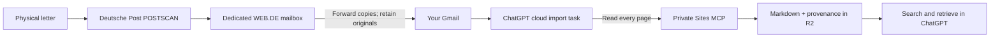

<p align="center"></p>

<p align="center"><strong>Postscan MCP</strong></p>

Turn scanned postal letters into searchable, page-labelled Markdown for ChatGPT. Keep the original PDFs in your mailbox and retrieve the saved text through a private, self-hosted MCP on ChatGPT Sites.

**Independent community project.** This software is not made, endorsed or operated by Deutsche Post, WEB.DE, Google or OpenAI. Each user creates their own private deployment and connects their own mailbox. This repository contains source code and synthetic tests, not a running shared mail service.

[Start here](#start-here) · [How it works](#how-it-works) · [Local verification](#local-verification)

## What is POSTSCAN?

[POSTSCAN](https://www.deutschepost.de/de/p/postscan.html) is Deutsche Post’s service for eligible private customers at a verified German address. Deutsche Post opens eligible incoming letters, scans their contents and makes the scans available in its customer account. Optional WEB.DE or GMX delivery sends scan copies to your mailbox. Some mail types are excluded, so the service does not digitize every physical delivery.

**[Subscribe in the official Deutsche Post shop](https://shop.deutschepost.de/postscan)**. As checked on **13 October 2026**, the base service costs **€14.99 for setup including the first month, then €14.99 per month**, for up to **15 scanned items per month**. Optional paper storage/delivery and digital-retention extensions cost extra. Consult the [official prices](https://www.deutschepost.de/de/p/postscan.html) and [FAQ](https://www.deutschepost.de/de/p/postscan/haeufige-fragen.html) before ordering; prices and terms may change.

After ordering, activate your address using the physically delivered AdressTAN, choose the start date and confirm mailbox delivery. The official FAQ describes the activation timeline and exclusions. **Original paper is normally destroyed by POSTSCAN unless you select its paid storage/delivery option.** This software’s “originals remain in mail” means the original digital PDF, not preservation of the paper letter. Shop scan retention is separate from your mailbox retention.

## How it works



The cloud task reads your authorized Gmail connection. The MCP temporarily reads signed attachment URLs, extracts native text and decoded scan images, and gives them to ChatGPT for visual transcription. It stores Markdown, page counts, review warnings and mailbox references in R2. It never archives the PDF or image binaries. The email’s inline image is often only page 1; it supplements a complete PDF rather than replacing its remaining pages.

The server is independent of your computer after deployment. Your connected ChatGPT account supplies mailbox access and runs the cloud import. Publishing a server alone does not collect mail or create a schedule.

## Start here

1. Read the [platform and privacy requirements](docs/PRIVACY.md).
2. Copy the [setup prompt](docs/SETUP_PROMPT.md) into ChatGPT/Codex, and follow the [complete setup tutorial](docs/SETUP.md), including historical backfill.
3. Use the [import task prompt](docs/IMPORT_PROMPT.md) and verify a cloud test, a timer-driven run and a genuinely new letter separately.
4. See [architecture and tool reference](docs/ARCHITECTURE.md) for implementation details and limitations.

**Sites’ current rules prohibit sensitive-data processing such as PHI or payment-card data, even in a private Site.** Use synthetic or otherwise permitted data and check current provider rules before importing real correspondence. The template’s technical ability to read a document does not establish permission to host it. Sites availability, account/workspace approvals and connected-app access can vary. See [OpenAI’s Sites guide](https://help.openai.com/en/articles/20001339-creating-and-using-chatgpt-sites).

## Included files

| Path | Purpose |
| --- | --- |
| `src/index.js` | Authenticated MCP, Markdown storage, deduplication and import health |
| `src/pdf-page.js` | Bounded in-memory scan-layer decoder |
| `.openai/hosting.json` | Generic Sites R2/MCP manifest, with no deployment identity |
| `scripts/` | Build, Site-ID configuration and publication checks |
| `test/` | Synthetic PDF and real local Worker/R2 tests |
| `assets/` | Editable original SVG and PNG icon |
| `docs/` | Subscription, deployment, mailbox relay and scheduling tutorial |

## Local verification

Use a supported Node.js runtime (Node 22 LTS or newer is the recommended starting point) and npm:

```bash
npm ci
npm run build
npm test
npm run check:public
```

The tests cover authorization, Markdown persistence, retries/conflicts, complete pagination, review correction/history, scan decoding and source-check reporting. They use fake identities and generated fixtures. They do not access a mailbox. An actual deployment and a cloud task need their own acceptance checks.

There is no separately billed AI API integration in this code. POSTSCAN is paid; ChatGPT plan/hosting limits and any storage/provider charges remain yours to check. This is not a guarantee of free unlimited hosting or OCR accuracy.

## License and branding

Project code and original icon are [MIT licensed](LICENSE). Dependency licenses are listed in [THIRD_PARTY_NOTICES.md](THIRD_PARTY_NOTICES.md). The icon uses postal yellow (`#FFCC00`) and an original envelope/scan design; it does not reproduce the Deutsche Post post-horn. Product names and trademarks remain their owners’ property.
